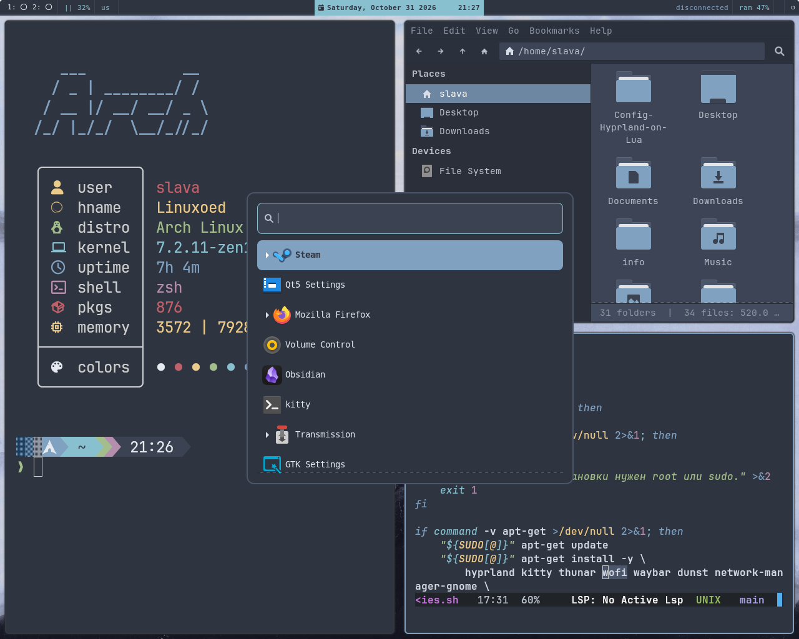

# Config-Hyprland-on-Lua

Моя конфигурация [Hyprland](https://hyprland.org/) на Lua в стиле Nord.

## Возможности

- Nord-тема с прозрачностью, скруглениями и анимациями
- Раскладки клавиатуры `us,ru`
- Автозапуск Waybar, Dunst и NetworkManager Applet
- Горячие клавиши для запуска приложений
- Скриншоты через Grim и Slurp
- Управление громкостью, яркостью и медиаплеером
- Жесты тачпада и переключение рабочих пространств
- Модульная Lua-конфигурация
- Профили `default`, `laptop` и `desktop`
- Единая Nord-тема для Hyprland, Waybar, Wofi и Kitty

## Интерфейс



Скриншот сохранён в формате PNG, размер `1280x1024`. Для соответствия
конфигурации на изображении должны быть видны или использоваться:

- Hyprland под Wayland;
- Nord-цвета, скруглённые углы, прозрачность и анимации из `Hyperland.lua`;
- панель Waybar;
- терминал Kitty;
- меню приложений Wofi;
- раскладки клавиатуры `us,ru`;
- обои через Hyprpaper, путь к скрипту: `~/.config/hypr/set_wallpaper.sh`;
- приложения и меню, указанные в `Hyperland.lua`: Thunar и Wofi.

При замене изображения сохраните его в корне репозитория и обновите имя файла
в Markdown-ссылке выше. Для воспроизводимого результата также укажите
разрешение монитора, масштабирование, используемые обои и версии Hyprland,
Waybar и Lua-конфигуратора.

## Установка

1. Склонируйте репозиторий:

   ```bash
   git clone https://github.com/dr0pper1331-code/Config-Hyprland-on-Lua.git
   cd Config-Hyprland-on-Lua
   ```

2. Установите зависимости:

   ```bash
   chmod +x setup.sh
   ./setup.sh
   ```

   Единый установщик проверяет файлы, устанавливает зависимости, размещает
   конфиги и проверяет результат. Поддерживаются Debian/Ubuntu и Arch Linux.

   Скрипт Hyprpaper выбирает случайное изображение из `~/Pictures/wallpapers`.
   Поддерживаются файлы `.jpg`, `.jpeg`, `.png` и `.webp`. Для другого
   каталога задайте переменную `WALLPAPER_DIR`.

   Скрипт можно запускать из любого каталога, если указать полный путь к
   `setup.sh`.

   Для повторной проверки используйте:

   ```bash
   ./setup.sh --check
   ```

   Для перечитывания конфигурации в запущенном Hyprland:

   ```bash
   ./setup.sh --reload
   ```

3. Установщик копирует Lua-модули и конфигурации Waybar, Wofi и Kitty в
   соответствующие каталоги `~/.config`.

4. Установите Zsh и Oh My Zsh, затем скопируйте `.zshrc` в домашний каталог:

   ```bash
   cp .zshrc ~/.zshrc
   ```

   `.zshrc` использует дополнительные программы `nitch`, `eza`, `bat`, `fd`,
   `zoxide`, `starship`, `fastfetch` и `trash`. Их можно установить отдельно;
   отсутствие Oh My Zsh выводится как предупреждение, а отсутствующие
   дополнительные команды не запускаются автоматически.

5. Выберите профиль перед запуском Hyprland:

   ```bash
   export HYPRLAND_PROFILE=laptop
   ```

   Доступны `default`, `laptop` и `desktop`. Профиль выбирает поведение
   тачпада, масштаб монитора и приложения. Конкретный монитор задаётся
   отдельно:

   ```bash
   export HYPRLAND_MONITOR="имя-монитора"
   ```

6. Проверьте и измените в `Hyperland.lua`:

   - имя монитора;
   - используемый терминал;
   - файловый менеджер;
   - меню приложений;
   - путь к скрипту обоев;
   - путь к изображению для Swaylock.

   Для выбора монитора можно задать переменную окружения перед запуском
   Hyprland:

   ```bash
   export HYPRLAND_MONITOR="имя-монитора"
   ```

   Если переменная не задана, применяется конфигурация монитора по умолчанию.

7. Перезапустите Hyprland.

## Основные горячие клавиши

| Комбинация | Действие |
|---|---|
| `Super + X` | Открыть терминал |
| `Super + R` | Открыть меню приложений |
| `Super + Shift + E` | Открыть файловый менеджер |
| `Super + Q` | Закрыть окно |
| `Super + F` | Полноэкранный режим |
| `Super + Shift + Space` | Переключить плавающее окно |
| `Super + P` | Сделать скриншот экрана |
| `Super + Shift + P` | Сделать скриншот выбранной области |
| `Super + U` | Заблокировать экран |
| `Super + Shift + W` | Сменить обои |
| `Super + 1..0` | Переключить рабочее пространство |

## Примечание

Конфигурация рассчитана на Wayland и требует адаптации путей и названий устройств под конкретную систему.
После выбора Zsh оболочкой по умолчанию терминал `kitty` запускает интерактивную
сессию, которая автоматически читает `~/.zshrc`.
